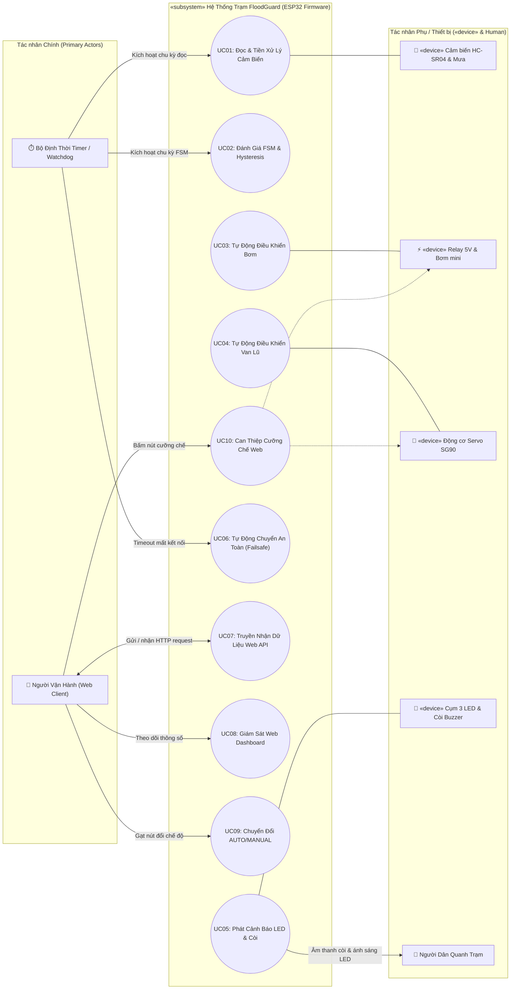

# 🌊 FloodGuard - Hệ Thống Giám Sát & Chống Ngập Thông Minh

Hệ thống IoT ứng dụng **ESP32** kết hợp cảm biến siêu âm HC-SR04, cảm biến mưa, động cơ Servo điều khiển van xả, Relay điều khiển máy bơm, còi cảnh báo và hệ thống Web Server giám sát qua Wi-Fi thời gian thực (hiển thị trực tiếp trên máy tính / điện thoại).

---

## 🛠️ Danh Sách Linh Kiện & Bảng Phân Công Chân (GPIO Mapping)

### 1. Bảng phân công chân phần cứng (GPIO Mapping)
| STT | Thiết bị / Module | Chân tín hiệu | GPIO ESP32 | Vị trí Breadboard | Ghi chú |
| :-: | :--- | :--- | :--- | :--- | :--- |
| 1 | **HC-SR04** (Siêu âm) | Trig | `GPIO 13` (D13) | Lỗ g38 bo trái | Phát xung siêu âm đo mặt nước |
| 1 | **HC-SR04** (Siêu âm) | Echo | `GPIO 12` (D12) | Lỗ g37 bo trái | Nhận xung phản hồi (nối tiếp trở hạn dòng) |
| 2 | **Cảm biến mưa** | DO (Digital) | `GPIO 34` (D34) | Lỗ b31 bo phải | Phát hiện mưa/khô – Input-only |
| 2 | **Cảm biến mưa** | AO (Analog) | `GPIO 35` (D35) | Lỗ b32 bo phải | Đo cường độ mưa qua ADC – Input-only |
| 3 | **Servo SG90** | PWM (Dây cam) | `GPIO 27` (D27) | Lỗ g35 bo trái | Điều khiển van xả lũ (0°, 90°, 180°) |
| 4 | **Relay 1 kênh** | IN | `GPIO 23` (D23) | Lỗ b37 bo phải | Đóng/ngắt máy bơm 5V – **Active LOW** |
| 5 | **LED Đỏ** (Nguy cấp) | Anode (+) | `GPIO 18` (D18) | Lỗ b39 bo phải | Báo CRITICAL / DANGER – qua trở 220Ω |
| 6 | **LED Vàng** (Cảnh báo) | Anode (+) | `GPIO 19` (D19) | Lỗ b38 bo phải | Báo WARNING – qua trở 220Ω |
| 7 | **LED Xanh** (An toàn) | Anode (+) | `GPIO 21` (D21) | Lỗ b36 bo phải | Báo NORMAL – qua trở 220Ω |
| 8 | **Buzzer 5V** | Cực (+) | `GPIO 4` (D4) | Lỗ b34 bo phải | Còi cảnh báo âm thanh đa cấp độ |
| – | **Nút điều khiển** | *Ảo (Web)* | *Giao diện Web* | – | **Điều khiển qua Web Dashboard** (không dùng nút vật lý) |

### 2. Danh sách linh kiện phần cứng tổng hợp
| STT | Linh kiện | Mô tả / Chân ESP32 |
| :-: | :--- | :--- |
| 1 | **ESP32 DevKit V1** | Vi điều khiển trung tâm (tích hợp Wi-Fi & Web Server) |
| 2 | **HC-SR04** | Đo khoảng cách mực nước (`TRIG: GPIO 13`, `ECHO: GPIO 12`), dải đo: 50cm (0% - cạn) đến 5cm (100% - đầy tràn) |
| 3 | **Cảm biến mưa** | Phát hiện và đo cường độ mưa (`DO: GPIO 34`, `AO: GPIO 35` – cả 2 chân Input-only) |
| 4 | **Servo SG90** | Điều khiển góc mở van xả 0° – 90° – 180° (`PWM: GPIO 27`) |
| 5 | **Relay 1 kênh 5V** | Điều khiển bật/tắt máy bơm mini (`IN: GPIO 23` – **Active LOW**) |
| 6 | **Buzzer 5V** | Còi báo động đa cấp độ (`SIG: GPIO 4`) |
| 7 | **Cụm 3 LED + Điện trở** | Xanh (`GPIO 21`), Vàng (`GPIO 19`), Đỏ (`GPIO 18`) kèm trở 220Ω |
| 8 | **Web Dashboard Controls** | Hệ thống nút bấm điều khiển ảo trên trình duyệt (chuyển Mode, Bật/Tắt Bơm, Đổi góc Van) |

---

## 📋 Phân Tích & Đặc Tả 10 Trường Hợp Sử Dụng (Use Cases)

### 🎯 Phân định Ranh giới Hệ thống & Tác nhân (Chuẩn UML 2.5)
Theo chuẩn mô hình hóa Use Case UML 2.5 cho hệ thống nhúng và IoT:
* **Ranh giới hệ thống (System Boundary):** Là phần mềm điều khiển trung tâm chạy trên ESP32 (**FloodGuard Firmware Controller**).
* **Tác nhân chính (Primary Actors - Đặt bên trái):**
  * **Người vận hành (Human Actor):** Tương tác từ xa qua trình duyệt Web Dashboard để theo dõi trạng thái, chuyển đổi chế độ và can thiệp cưỡng chế thiết bị.
  * **Bộ định thời Timer / Watchdog (Internal Timer):** Kích hoạt định kỳ chu kỳ đo cảm biến, chu kỳ FSM và giám sát timeout mất mạng để chuyển về AUTO (Failsafe).
* **Tác nhân phụ / Thiết bị ngoại vi (Secondary Actors - Đặt bên phải):**
  * **`«device»` Cảm biến siêu âm HC-SR04 & Cảm biến mưa FC-37:** Cung cấp tín hiệu xung Echo và ADC/DO.
  * **`«device»` Module Relay 5V & Máy bơm mini:** Nhận lệnh đóng/ngắt nguồn cho bơm.
  * **`«device»` Động cơ Servo SG90:** Nhận xung PWM xoay góc mở van xả lũ (0°, 90°, 180°).
  * **`«device»` Cụm 3 Đèn LED & Còi Buzzer 5V:** Nhận tín hiệu điều khiển cảnh báo tại trạm.
  * **Người dân quanh trạm (Human Actor):** Thụ hưởng và tiếp nhận âm thanh báo động còi hú và ánh sáng chỉ thị LED tại thực địa.

---

### 🗺️ Sơ đồ tổng thể Use Case hệ thống (Use Case Diagram)




---

### 📝 Chi tiết đặc tả 10 Use Case

#### 🔹 UC01: Đọc và tiền xử lý dữ liệu cảm biến
* **Mã định danh:** `UC01`
* **Tác nhân:** 
  * *Tác nhân chính:* Bộ định thời Timer 100ms.
  * *Tác nhân phụ:* `«device»` Cảm biến siêu âm HC-SR04, `«device»` Cảm biến mưa FC-37.
* **Mục tiêu:** Thu thập dữ liệu cảm biến sạch, loại bỏ xung gai nhiễu điện từ (EMI) và tính toán quy đổi ra % mực nước cùng các cấp độ mưa.
* **Tiền điều kiện:** Cảm biến được cấp nguồn ổn định; chân Trig/Echo và AO/DO nối đúng sơ đồ chân.
* **Quan hệ «include» (Chuẩn UML 2.5):** UC01 trực tiếp gọi đồng thời 3 Use Case con (không nối chuỗi):
  1. *Đo khoảng cách siêu âm (HC-SR04):* Kích xung Trig 10µs, đọc độ rộng xung Echo qua `pulseIn()`.
  2. *Lọc trung vị 3 mẫu & Tính % nước:* Thuật toán Median Filter 3 mẫu loại bỏ gai nhiễu, quy đổi 50cm-5cm về 0%-100%.
  3. *Đọc tín hiệu mưa & Phân cấp ADC/DO:* Đọc giá trị ADC và phân loại 3 cấp độ (mưa nhỏ, mưa to, ngập nước).
* **Hậu điều kiện:** Cung cấp thông số chuẩn hóa `waterPercent`, `currentDistance`, `rainRawADC`, `isRaining`, `isHeavyRain`, `isSubmerged` cho FSM và Web Server.


---

#### 🔹 UC02: Tự động đánh giá ngưỡng trạng thái và xử lý chống rung (Hysteresis)
* **Mã định danh:** `UC02`
* **Tác nhân chính:** Bộ định thời chu kỳ FSM (kích hoạt định kỳ).
* **Mục tiêu:** Xác định trạng thái vận hành của trạm và triệt tiêu hiện tượng rung giật đóng/ngắt thiết bị liên tục (chattering/jittering) khi mặt nước dập dềnh quanh biên ngưỡng.
* **Tiền điều kiện:** Hệ thống đang ở chế độ `AUTO MODE` và dữ liệu cảm biến từ `UC01` đã sẵn sàng.
* **Quan hệ «include»:** UC02 trực tiếp gọi:
  * *Đánh giá 4 cấp độ (NORMAL - CRITICAL):* Đối chiếu % nước và cấp mưa với bảng quy tắc ngưỡng.
  * *Áp dụng dải trễ Hysteresis chống rung:* Giữ xả cho đến khi nước rút sâu < 40% mới hạ trạng thái.
* **Hậu điều kiện:** Biến `sysState` được cập nhật chính xác, kích hoạt điều khiển đồng bộ cho UC03, UC04, UC05.


---

#### 🔹 UC03: Tự động điều khiển máy bơm thoát nước
* **Mã định danh:** `UC03`
* **Tác nhân:** 
  * *Tác nhân chính:* Trình điều phối FSM.
  * *Tác nhân phụ:* `«device»` Module Relay 5V & Máy bơm mini 5V.
* **Mục tiêu:** Tự động kích hoạt máy bơm khi đạt ngưỡng nguy cơ và ngừng bơm khi nước đã rút về mức an toàn.
* **Tiền điều kiện:** Chế độ `isAutoMode == true`.
* **Quan hệ «include»:** UC03 trực tiếp gọi:
  * *Kích Relay Active LOW:* Bật bơm khi FSM ở mức DANGER hoặc CRITICAL.
  * *Thả nổi High-Z INPUT:* Triệt tiêu dòng rò optocoupler 5V, ngắt bơm dứt điểm 100% khi an toàn.
* **Hậu điều kiện:** Bơm duy trì hoạt động hoặc ngắt nghỉ đúng quy trình an toàn.


---

#### 🔹 UC04: Tự động điều khiển góc mở van thoát lũ
* **Mã định danh:** `UC04`
* **Tác nhân:** 
  * *Tác nhân chính:* Trình điều phối FSM.
  * *Tác nhân phụ:* `«device»` Động cơ Servo SG90.
* **Mục tiêu:** Điều tiết lưu lượng xả lũ tự động tương ứng theo mức độ ngập của trạm.
* **Tiền điều kiện:** Chế độ `isAutoMode == true`.
* **Quan hệ «include»:** UC04 trực tiếp gọi:
  * *Xuất PWM mở van 50% góc 90°:* Khi FSM chạm mức DANGER.
  * *Xuất PWM mở van 100% góc 180°:* Khi FSM chạm mức CRITICAL.
* **Hậu điều kiện:** Cửa van đạt góc mở chính xác, duy trì ổn định dòng xả lũ.


---

#### 🔹 UC05: Tự động phát tín hiệu cảnh báo tại trạm (LED & Buzzer)
* **Mã định danh:** `UC05`
* **Tác nhân:** 
  * *Tác nhân chính:* Trình điều phối FSM.
  * *Tác nhân phụ:* `«device»` Cụm 3 Đèn LED & Còi Buzzer 5V.
  * *Tác nhân thụ hưởng:* Người dân quanh trạm (tiếp nhận âm thanh/ánh sáng).
* **Mục tiêu:** Cảnh báo trực quan tại chỗ bằng đèn LED và âm thanh đa cấp độ mà không gây chặn luồng xử lý (*Non-blocking*).
* **Quan hệ «include»:** UC05 trực tiếp gọi:
  * *Chỉ thị LED trực quan:* Xanh (NORMAL), Vàng (WARNING), Đỏ (DANGER/CRITICAL).
  * *Kích âm còi Non-blocking (millis):* Nhịp bíp dồn dập hoặc hú liên tục theo cấp nguy hiểm.
* **Hậu điều kiện:** Trạm phát tín hiệu báo động chuẩn xác, âm thanh tương thích với cấp độ nguy hiểm.


---

#### 🔹 UC06: Tự động chuyển đổi an toàn khi mất kết nối mạng (Failsafe to AUTO)
* **Mã định danh:** `UC06`
* **Tác nhân:** 
  * *Tác nhân kích hoạt chính:* Bộ giám sát Watchdog / Timeout (ESP32).
  * *Tác nhân thụ hưởng / nhận thông báo:* Người vận hành (mất quyền can thiệp khi rớt mạng).
* **Mục tiêu:** Bảo vệ trạm tự động chống ngập úng khi người vận hành mất quyền giám sát từ xa hoặc rớt mạng Wi-Fi.
* **Tiền điều kiện:** Hệ thống đang bị người vận hành gạt sang `MANUAL MODE`.
* **Quan hệ «include»:** UC06 trực tiếp gọi:
  * *Kiểm tra timeout kết nối Wi-Fi / Web:* Đếm chu kỳ không nhận được request từ client.
  * *Cưỡng chế đảo cờ isAutoMode = true:* Chuyển ngay về AUTO MODE, trao lại quyền cho FSM.
* **Hậu điều kiện:** Trạm duy trì tính năng tự trị (*Autonomous Controller*), ngăn ngừa rủi ro ngập úng khi người dùng để quên ở chế độ thủ công.


---

#### 🔹 UC07: Truyền nhận dữ liệu thời gian thực qua giao thức Web (Telemetry & API)
* **Mã định danh:** `UC07`
* **Tác nhân:** 
  * *Tác nhân chính:* Người vận hành (gửi HTTP request và nhận dữ liệu telemetry).
  * *Tác nhân phụ:* ESP32 Web Server (thư viện `WebServer.h`, cổng 80).
* **Mục tiêu:** Cung cấp các giao diện lập trình ứng dụng (REST API endpoints) đóng gói JSON để truyền tải thông số đo và nhận lệnh điều khiển.
* **Quan hệ «include»:** UC07 trực tiếp gọi:
  * *Đóng gói chuỗi JSON (GET /api/status):* Xuất dữ liệu % nước, cấp mưa, trạng thái thiết bị.
  * *Tiếp nhận gói lệnh (GET /api/control):* Giải mã lệnh chuyển mode, bơm, van.
* **Hậu điều kiện:** Dữ liệu thời gian thực được đồng bộ hai chiều liên tục giữa ESP32 và Web Client.


---

#### 🔹 UC08: Giám sát trạng thái trạm từ xa trên Giao diện Web
* **Mã định danh:** `UC08`
* **Tác nhân:** Người vận hành (quan sát trực quan thông số).
* **Mục tiêu:** Hiển thị trực quan dữ liệu đo đạc và trạng thái phần cứng trên máy tính/điện thoại mà không cần màn hình LCD vật lý tại trạm.
* **Tiền điều kiện:** Thiết bị người dùng đã kết nối vào mạng Wi-Fi của trạm (`FloodGuard_AP`) hoặc cùng Router Wi-Fi.
* **Quan hệ «include»:** UC08 trực tiếp gọi:
  * *Hiển thị đồng hồ mực nước % & khoảng cách:* Vòng đo trực quan và thanh tiến trình.
  * *Cập nhật trạng thái bơm, van xả & còi:* Thẻ badge động theo thời gian thực.
* **Hậu điều kiện:** Người dùng nắm bắt toàn diện diễn biến thời gian thực của trạm từ xa.


---

#### 🔹 UC09: Chuyển đổi chế độ vận hành từ xa (AUTO / MANUAL)
* **Mã định danh:** `UC09`
* **Tác nhân:** Người vận hành (gạt nút chuyển chế độ).
* **Mục tiêu:** Phân quyền điều khiển linh hoạt giữa thuật toán tự động thông minh và sự can thiệp thủ công của con người.
* **Quan hệ «extend» (Chuẩn UML 2.5):** Hai nhánh độc lập có mũi tên nét đứt trỏ ngược về Use Case cơ sở UC09:
  * *Khóa phím Web, giao quyền tự động cho FSM* $\xrightarrow{\text{«extend» [khi chọn AUTO]}}$ UC09.
  * *Mở khóa nút bấm, cho phép can thiệp thủ công* $\xrightarrow{\text{«extend» [khi chọn MANUAL]}}$ UC09.
* **Hậu điều kiện:** Quyền điều khiển được chuyển giao an toàn giữa vi điều khiển và người dùng.


---

#### 🔹 UC10: Điều khiển cưỡng chế thiết bị chấp hành từ Giao diện Web
* **Mã định danh:** `UC10`
* **Tác nhân:** 
  * *Tác nhân chính:* Người vận hành (nhấp phím lệnh can thiệp).
  * *Tác nhân phụ:* `«device»` Module Relay 5V & Máy bơm mini, `«device»` Động cơ Servo SG90.
* **Mục tiêu:** Bật/tắt bơm hoặc xoay góc van xả thủ công phục vụ kiểm tra thiết bị định kỳ, xả cặn đáy hồ, hoặc xử lý sự cố khẩn cấp.
* **Tiền điều kiện:** Hệ thống đang ở chế độ `MANUAL MODE` (`isAutoMode == false`).
* **Quan hệ «extend» (Chuẩn UML 2.5):** Hai nhánh can thiệp mở rộng độc lập trỏ ngược về Use Case cơ sở UC10:
  * *Bật / Tắt cưỡng chế máy bơm thoát nước* $\xrightarrow{\text{«extend» [khi lệnh Bơm]}}$ UC10.
  * *Điều khiển cưỡng chế góc van xả (0° / 90° / 180°)* $\xrightarrow{\text{«extend» [khi lệnh Van]}}$ UC10.
* **Hậu điều kiện:** Thiết bị chấp hành vận hành chính xác theo ý muốn của người điều khiển bất chấp giá trị cảm biến hiện tại.


  1. Người dùng nhấn các nút thao tác trên Dashboard Web:
     * Nhấn **"Bật/Tắt Bơm (Manual)"**: Gửi lệnh `pump_toggle`. ESP32 đảo trạng thái biến `pumpState` và kích hoạt Relay qua kỹ thuật High-Z.
     * Nhấn **"Van 0% (Đóng)"**, **"Van 50% (Mở Nửa)"**, hoặc **"Van 100% (Mở Hết)"**: Gửi lệnh `valve_0`, `valve_50`, hoặc `valve_100`. ESP32 điều khiển Servo quay tương ứng về $0^\circ, 90^\circ$, hoặc $180^\circ$.
  2. ESP32 áp đặt đầu ra phần cứng ngay lập tức qua hàm `applyOutputs()`.
  3. Web Server trả về mã phản hồi `200 OK`, Dashboard cập nhật trạng thái thiết bị hiển thị lên màn hình.
* **Hậu điều kiện:** Thiết bị chấp hành vận hành chính xác theo ý muốn của người điều khiển bất chấp giá trị cảm biến hiện tại.


---

---

## 🚦 Các Trạng Thái Vận Hành & Ngưỡng Kích Hoạt
Hệ thống sử dụng cảm biến siêu âm với **khoảng đo từ 50cm (đáy hồ/cạn hoàn toàn - 0%) đến 5cm (mặt hồ đầy tràn - 100%)**, dải chênh lệch $45\text{ cm}$.

Áp dụng thuật toán **FSM & Hysteresis** chống dao động bật/tắt thiết bị với hệ thống cảnh báo đa tầng:
- **🟢 NORMAL (0 – 20% | Khoảng cách 50cm – 41cm)**: Mực nước an toàn. LED xanh sáng, Bơm OFF, Van đóng 0%, Còi OFF (yên lặng).
- **🟡 WARNING (21 – 40% | Khoảng cách 40.5cm – 32cm)**: Nước bắt đầu dâng. LED vàng sáng, **Còi báo nhẹ (tiếng bíp ngắn ngắt quãng thưa)** nhắc nhở kỹ thuật viên.
- **🔴 DANGER (41 – 70% | Khoảng cách 31.5cm – 18.5cm)**: Nguy cơ ngập. LED đỏ sáng, Bơm ON, Van mở 50% (90°), **Còi báo dồn dập (nhịp bíp nhanh)** cảnh báo nguy hiểm.
- **🚨 CRITICAL (71 – 100% | Khoảng cách 18cm – 5cm)**: Ngập nghiêm trọng. LED đỏ nhấp nháy dồn dập, **Còi hú liên tục không ngắt**, Bơm ON, Van mở thoát lũ tối đa 100% (180°).
- **Hysteresis khi nước rút**: Khi mực nước giảm, Bơm và Van vẫn duy trì thoát nước cho đến khi mực nước rút hẳn xuống dưới **40% (khoảng cách > 32cm)** mới ngắt Bơm đóng Van, và giảm sâu dưới **20% (khoảng cách > 41cm)** mới trở lại NORMAL.

---

## 🌐 Giám Sát & Điều Khiển Từ Xa (Web Dashboard)
- Tích hợp **Web Server** trên ESP32 (cổng 80).
- Giao diện Dashboard Dark Glassmorphism theo dõi:
  - Thanh đo mực nước hồ thu (%) thời gian thực.
  - Trạng thái thời tiết / cảm biến mưa.
  - Trạng thái máy bơm, góc mở van, còi hú.
  - Chuyển đổi linh hoạt giữa chế độ **AUTO** và **MANUAL**.
  - Can thiệp điều khiển thủ công Bơm và Van trực tiếp qua các nút bấm trên giao diện Web Dashboard (chuyển Mode AUTO/MANUAL, Bật/Tắt Bơm, mở Van 0% - 50% - 100%). Không phụ thuộc vào nút nhấn cơ học giúp tăng độ bền chống ẩm ướt trong môi trường ngập lụt.
- 👉 Chi tiết kiến trúc và các bước thiết lập Wi-Fi / Web Server xem tại: [WEB_DASHBOARD_SETUP_GUIDE.md](WEB_DASHBOARD_SETUP_GUIDE.md).

---

## 🚀 Hướng Dẫn Chạy Giả Lập Wokwi
1. Cài đặt extension **Wokwi for VS Code** và **PlatformIO IDE**.
2. Biên dịch firmware bằng PlatformIO:
   ```bash
   pio run
   ```
   *(hoặc nhấn tổ hợp phím `Ctrl + Shift + B`)*
3. Mở file `diagram.json` và nhấn nút **Start Simulation** (hoặc nhấn `F1` chọn `Wokwi: Start Simulator`).

👉 Xem hướng dẫn chi tiết từng bước và bảng lệnh tại file: [SIMULATION_GUIDE.md](SIMULATION_GUIDE.md).
