# 🌊 FloodGuard - Hệ Thống Giám Sát & Chống Ngập Thông Minh

Hệ thống IoT ứng dụng **ESP32** kết hợp cảm biến siêu âm HC-SR04, cảm biến mưa, động cơ Servo điều khiển van xả, Relay điều khiển máy bơm, còi cảnh báo và hệ thống Web Server giám sát qua Wi-Fi thời gian thực (hiển thị trực tiếp trên máy tính / điện thoại).

---

## 🛠️ Danh Sách Linh Kiện & Bảng Phân Công Chân (GPIO Mapping)

### 1. Bảng phân công chân phần cứng (GPIO Mapping)
| STT | Thiết bị / Module | Chân tín hiệu | GPIO ESP32 | Vị trí Breadboard | Ghi chú |
| :-: | :--- | :--- | :--- | :--- | :--- |
| 1 | **HC-SR04** (Siêu âm) | Trig | `GPIO 13` (D13) | Lỗ g38 bo trái | Phát xung siêu âm đo mặt nước |
| 1 | **HC-SR04** (Siêu âm) | Echo | `GPIO 12` (D12) | Lỗ g37 bo trái | Nhận xung phản hồi (nối tiếp trở hạn dòng) |
| 2 | **Cảm biến mưa** | DO (Digital) | `GPIO 34` (D34) | Lỗ b31 bo phải | Phát hiện mưa/khô – Input-only |
| 2 | **Cảm biến mưa** | AO (Analog) | `GPIO 35` (D35) | Lỗ b32 bo phải | Đo cường độ mưa qua ADC – Input-only |
| 3 | **Servo SG90** | PWM (Dây cam) | `GPIO 27` (D27) | Lỗ g35 bo trái | Điều khiển van xả lũ (0°, 90°, 180°) |
| 4 | **Relay 1 kênh** | IN | `GPIO 23` (D23) | Lỗ b37 bo phải | Đóng/ngắt máy bơm 5V – **Active LOW** |
| 5 | **LED Đỏ** (Nguy cấp) | Anode (+) | `GPIO 18` (D18) | Lỗ b39 bo phải | Báo CRITICAL / DANGER – qua trở 220Ω |
| 6 | **LED Vàng** (Cảnh báo) | Anode (+) | `GPIO 19` (D19) | Lỗ b38 bo phải | Báo WARNING – qua trở 220Ω |
| 7 | **LED Xanh** (An toàn) | Anode (+) | `GPIO 21` (D21) | Lỗ b36 bo phải | Báo NORMAL – qua trở 220Ω |
| 8 | **Buzzer 5V** | Cực (+) | `GPIO 4` (D4) | Lỗ b34 bo phải | Còi cảnh báo âm thanh đa cấp độ |
| – | **Nút điều khiển** | *Ảo (Web)* | *Giao diện Web* | – | **Điều khiển qua Web Dashboard** (không dùng nút vật lý) |

### 2. Danh sách linh kiện phần cứng tổng hợp
| STT | Linh kiện | Mô tả / Chân ESP32 |
| :-: | :--- | :--- |
| 1 | **ESP32 DevKit V1** | Vi điều khiển trung tâm (tích hợp Wi-Fi & Web Server) |
| 2 | **HC-SR04** | Đo khoảng cách mực nước (`TRIG: GPIO 13`, `ECHO: GPIO 12`), dải đo: 50cm (0% - cạn) đến 5cm (100% - đầy tràn) |
| 3 | **Cảm biến mưa** | Phát hiện và đo cường độ mưa (`DO: GPIO 34`, `AO: GPIO 35` – cả 2 chân Input-only) |
| 4 | **Servo SG90** | Điều khiển góc mở van xả 0° – 90° – 180° (`PWM: GPIO 27`) |
| 5 | **Relay 1 kênh 5V** | Điều khiển bật/tắt máy bơm mini (`IN: GPIO 23` – **Active LOW**) |
| 6 | **Buzzer 5V** | Còi báo động đa cấp độ (`SIG: GPIO 4`) |
| 7 | **Cụm 3 LED + Điện trở** | Xanh (`GPIO 21`), Vàng (`GPIO 19`), Đỏ (`GPIO 18`) kèm trở 220Ω |
| 8 | **Web Dashboard Controls** | Hệ thống nút bấm điều khiển ảo trên trình duyệt (chuyển Mode, Bật/Tắt Bơm, Đổi góc Van) |

---

## 📋 Phân Tích & Đặc Tả 10 Trường Hợp Sử Dụng (Use Cases)

Trong thiết kế hệ thống nhúng thời gian thực (Real-Time Embedded Systems), **Ranh giới hệ thống (System Boundary)** được xác định là **Firmware / Bộ điều khiển trung tâm ESP32**. Mọi đối tượng bên ngoài ranh giới này tương tác, tạo kích thích (*Stimulus*) hoặc nhận phản hồi (*Response*) đều là **Tác nhân (Actor)**:
1. **Tác nhân Môi trường vật lý (Environmental Actors):** Mặt nước hồ thu / Khối nước lũ (phản xạ sóng siêu âm), Hạt mưa / Nước đọng (thay đổi điện trở bề mặt bản cực cảm biến).
2. **Tác nhân Ngoại vi phần cứng (Hardware Peripheral Actors):** Khối cảm biến (HC-SR04, Cảm biến mưa FC-37/LM393), Khối chấp hành (Relay & Máy bơm 5V, Servo SG90, Cụm 3 LED, Còi Buzzer 5V).
3. **Tác nhân Con người & Hệ thống mạng (Human & Network Actors):** Người vận hành / Giám sát viên qua Trình duyệt Web, Hạ tầng mạng Wi-Fi (SoftAP / Station).

---

### 🗺️ Sơ đồ tổng thể Use Case hệ thống (Use Case Diagram)

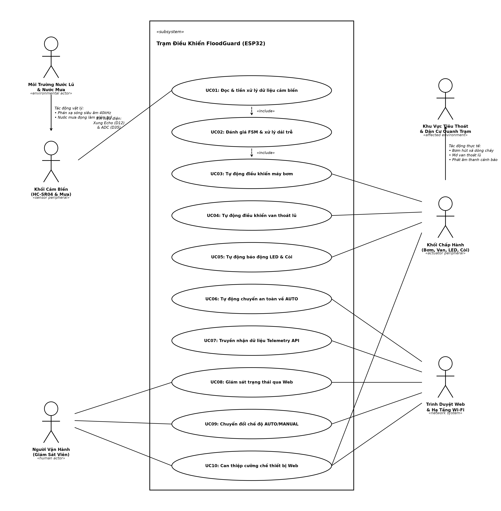

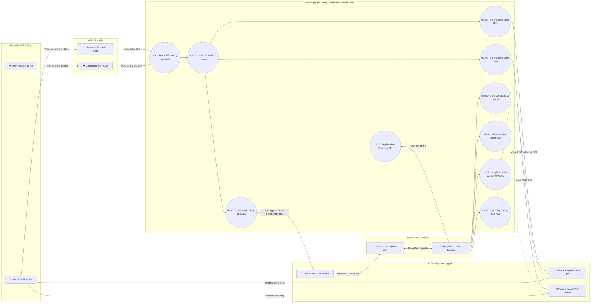

---

### 📝 Chi tiết đặc tả 10 Use Case

#### 🔹 UC01: Đọc và tiền xử lý dữ liệu cảm biến
* **Mã định danh:** `UC01`
* **Tác nhân:** 
  * *Tác nhân Môi trường:* Khối nước hồ thu / Mặt thoáng dập dềnh (tác động phản xạ sóng siêu âm), Hạt mưa rơi / Nước đọng (tác động cơ học và dẫn điện).
  * *Tác nhân Ngoại vi:* Cảm biến siêu âm HC-SR04 (Trig/Echo), Cảm biến mưa FC-37 (DO/AO).
  * *Tác nhân Vi điều khiển:* ESP32 (Module GPIO Timer, ADC 12-bit).
* **Mục tiêu:** Thu thập dữ liệu cảm biến sạch, loại bỏ xung gai nhiễu điện từ (EMI) và tính toán quy đổi ra % mực nước cùng các cấp độ mưa.
* **Tiền điều kiện:** Cảm biến được cấp nguồn ổn định; chân Trig/Echo và AO/DO nối đúng sơ đồ chân.
* **Luồng sự kiện chính:**
  1. ESP32 định kỳ kích xung phát 10µs chân Trig (GPIO 13), đọc xung phản hồi Echo (GPIO 12) qua hàm `pulseIn()` với timeout 25ms.
  2. Áp dụng **Bộ lọc trung vị (Median Filter of 3 samples)**: Lấy 3 mẫu liên tiếp cách nhau 12ms, loại bỏ mẫu ngoài dải ($2\text{cm} - 300\text{cm}$), sắp xếp lấy mẫu ở giữa; nếu lỗi do sụt áp thoáng qua thì giữ giá trị hợp lệ gần nhất (`lastValidDistance`).
  3. Quy đổi khoảng cách thô sang phần trăm mực nước: $0\%$ (cạn $50\text{cm}$) đến $100\%$ (đầy tràn $5\text{cm}$).
  4. Đọc chân số `DO` (GPIO 34) và chân tương tự `AO` (GPIO 35, ADC 12-bit), phân loại 3 cấp độ: Mưa nhỏ ($< 2800$), Mưa to ($< 1800$), Ngập nước ($< 1100$).
* **Hậu điều kiện:** Cung cấp thông số chuẩn hóa `waterPercent`, `currentDistance`, `rainRawADC`, `isRaining`, `isHeavyRain`, `isSubmerged` cho FSM và Web Server.

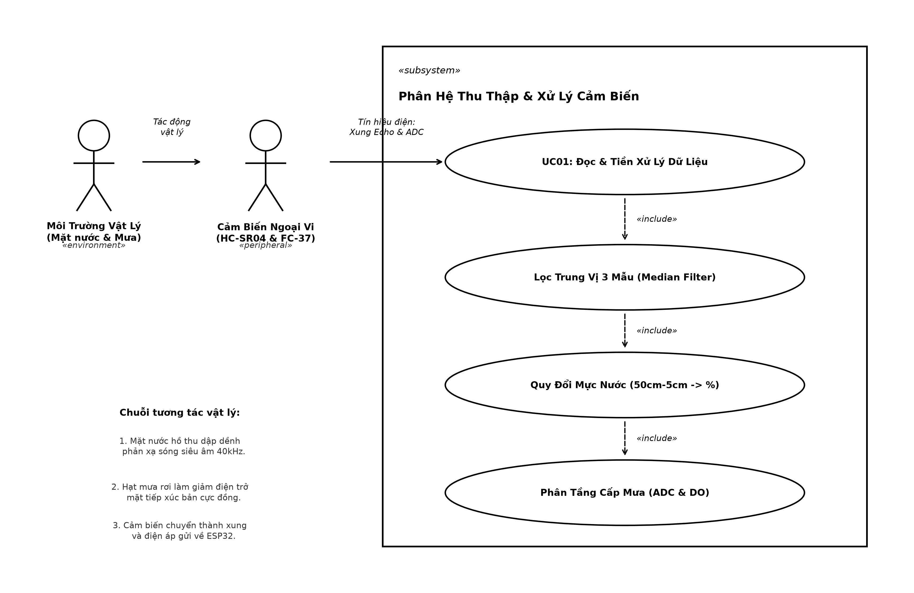

---

#### 🔹 UC02: Tự động đánh giá ngưỡng trạng thái và xử lý chống rung (Hysteresis)
* **Mã định danh:** `UC02`
* **Tác nhân:** ESP32 Firmware (Máy trạng thái hữu hạn - Finite State Machine).
* **Mục tiêu:** Xác định trạng thái vận hành của trạm và triệt tiêu hiện tượng rung giật đóng/ngắt thiết bị liên tục (chattering/jittering) khi mặt nước dập dềnh quanh biên ngưỡng.
* **Tiền điều kiện:** Hệ thống đang ở chế độ `AUTO MODE` và dữ liệu cảm biến từ `UC01` đã sẵn sàng.
* **Luồng sự kiện chính:**
  1. ESP32 đối chiếu `waterPercent` và cấp độ mưa với bảng quy tắc 4 trạng thái:
     * **NORMAL (An toàn):** Nước $\le 20\%$, tạnh mưa.
     * **WARNING (Cảnh báo sớm):** Nước $21\% - 40\%$ hoặc phát hiện có mưa nhỏ.
     * **DANGER (Nguy cơ ngập):** Nước $41\% - 70\%$ hoặc có mưa to.
     * **CRITICAL (Nguy cấp):** Nước $\ge 71\%$ hoặc cảm biến mưa ngập hoàn toàn trong nước.
  2. Áp dụng cơ chế **Dải trễ (Hysteresis)** khi nước rút:
     * Từ CRITICAL giảm xuống DANGER khi nước $< 71\%$ và hết ngập cảm biến mưa.
     * Từ DANGER giảm xuống WARNING khi nước rút sâu $< 40\%$ (chênh lệch $\Delta = 1\%$ chống rung giật) và không còn mưa to.
     * Từ WARNING giảm về NORMAL chỉ khi nước rút sâu $< 20\%$ và tạnh mưa hoàn toàn.
* **Hậu điều kiện:** Biến `sysState` được cập nhật chính xác, kích hoạt điều khiển đồng bộ cho UC03, UC04, UC05.

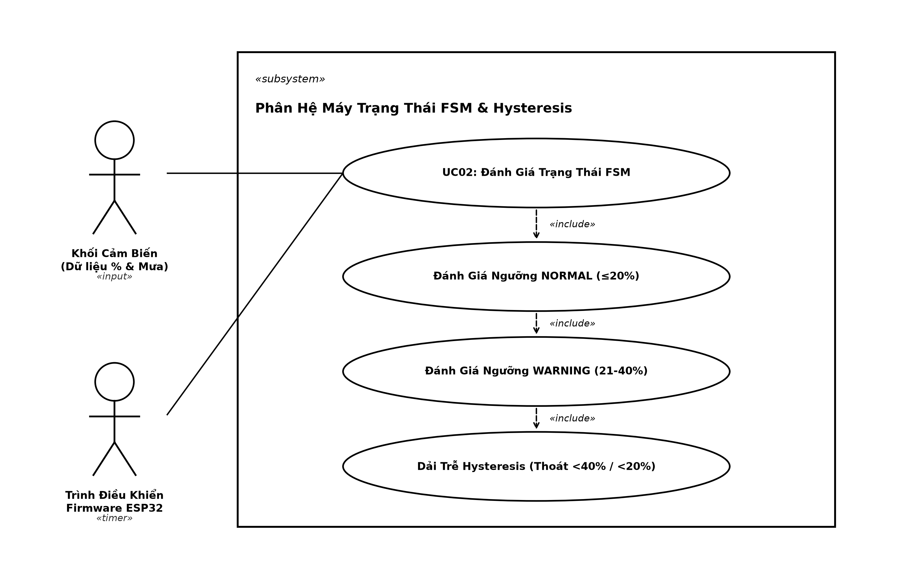

---

#### 🔹 UC03: Tự động điều khiển máy bơm thoát nước
* **Mã định danh:** `UC03`
* **Tác nhân:** 
  * *Tác nhân Vi điều khiển:* ESP32 (GPIO 23).
  * *Tác nhân Ngoại vi:* Module Relay 1 kênh 5V (Active LOW, optocoupler), Máy bơm chìm mini 5V.
  * *Tác nhân Môi trường:* Khối nước cần được bơm tiêu thoát ra ngoài bể chứa.
* **Mục tiêu:** Tự động kích hoạt máy bơm khi đạt ngưỡng nguy cơ và ngừng bơm khi nước đã rút về mức an toàn.
* **Tiền điều kiện:** Chế độ `isAutoMode == true`.
* **Luồng sự kiện chính:**
  1. Khi FSM chạm mức `DANGER` (nước $\ge 41\%$ hoặc mưa to) hoặc `CRITICAL`: ESP32 bật bơm bằng cách cấu hình `pinMode(PIN_RELAY, OUTPUT)` và kéo chân xuống mức `LOW`. Tiếp điểm Relay đóng, cấp nguồn cho máy bơm mini chạy.
  2. Khi nước rút xuống dưới ngưỡng an toàn $< 40\%$ và tạnh mưa to: ESP32 tắt bơm bằng **kỹ thuật High-Z** `pinMode(PIN_RELAY, INPUT)`. Chân GPIO thả nổi trở kháng cao, triệt tiêu hoàn toàn dòng rò $1.5\text{mA}$ qua optocoupler 5V, đảm bảo bơm ngắt dứt điểm $100\%$.
* **Hậu điều kiện:** Bơm duy trì hoạt động hoặc ngắt nghỉ đúng quy trình an toàn.

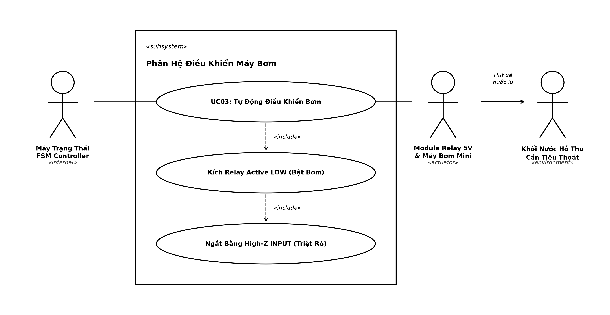

---

#### 🔹 UC04: Tự động điều khiển góc mở van thoát lũ
* **Mã định danh:** `UC04`
* **Tác nhân:** 
  * *Tác nhân Vi điều khiển:* ESP32 (GPIO 27 - PWM Timer Hardware).
  * *Tác nhân Ngoại vi:* Động cơ Servo SG90, Cửa van xả lũ hồ thu.
  * *Tác nhân Môi trường:* Lưu lượng dòng chảy nước lũ xả qua cửa cống.
* **Mục tiêu:** Điều tiết lưu lượng xả lũ tự động tương ứng theo mức độ ngập của trạm.
* **Tiền điều kiện:** Chế độ `isAutoMode == true`.
* **Luồng sự kiện chính:**
  1. ESP32 ánh xạ trạng thái FSM sang góc mở van thông qua hàm `map()`:
     * `NORMAL` hoặc `WARNING`: Góc mở $0^\circ$ (Độ mở $0\%$ - Đóng kín van giữ nước).
     * `DANGER`: Góc mở $90^\circ$ (Độ mở $50\%$ - Mở xả dòng chảy mức trung bình).
     * `CRITICAL`: Góc mở $180^\circ$ (Độ mở $100\%$ - Mở xả lũ tối đa khẩn cấp).
  2. Xuất xung PWM độ rộng $500\mu\text{s} - 2400\mu\text{s}$ đến chân cam động cơ Servo SG90 để kéo trục van mở đúng góc.
* **Hậu điều kiện:** Cửa van đạt góc mở chính xác, duy trì ổn định dòng xả lũ.

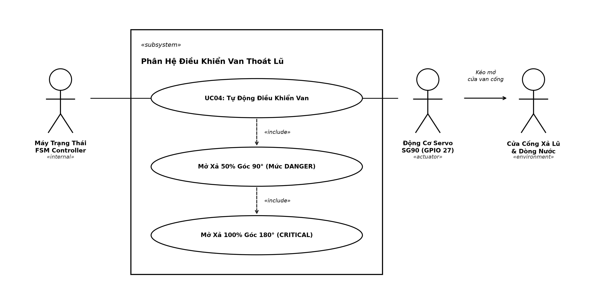

---

#### 🔹 UC05: Tự động phát tín hiệu cảnh báo tại trạm (LED & Buzzer)
* **Mã định danh:** `UC05`
* **Tác nhân:** 
  * *Tác nhân Vi điều khiển:* ESP32 (GPIO 21, 19, 18, 4).
  * *Tác nhân Ngoại vi:* Cụm 3 LED chỉ thị (Xanh D21, Vàng D19, Đỏ D18), Còi báo động Active Buzzer 5V (D4).
  * *Tác nhân Con người:* Người dân và kỹ thuật viên xung quanh trạm đo (tiếp nhận âm thanh/ánh sáng).
* **Mục tiêu:** Cảnh báo trực quan tại chỗ bằng đèn LED và âm thanh đa cấp độ mà không gây chặn luồng xử lý (*Non-blocking*).
* **Tiền điều kiện:** Chân GPIO LED và Buzzer được khởi tạo OUTPUT.
* **Luồng sự kiện chính:**
  1. Quản lý nhịp bíp bằng hàm `millis()` không dùng `delay()`:
     * **NORMAL:** LED Xanh bật sáng; LED Vàng và Đỏ tắt; Còi tắt hoàn toàn (`noTone`).
     * **WARNING:** LED Vàng bật sáng; Còi phát xung $1000\text{Hz}$ nhịp thưa (bíp 120ms mỗi chu kỳ 1.5 giây).
     * **DANGER:** LED Đỏ bật sáng; Còi phát xung $1800\text{Hz}$ nhịp dồn dập (kêu 150ms, ngắt 150ms theo chu kỳ 300ms).
     * **CRITICAL:** LED Đỏ chớp nhấp nháy nhanh chu kỳ 100ms; Còi hú liên tục không ngắt ở tần số cao $2500\text{Hz}$.
* **Hậu điều kiện:** Trạm phát tín hiệu báo động chuẩn xác, âm thanh tương thích với cấp độ nguy hiểm.

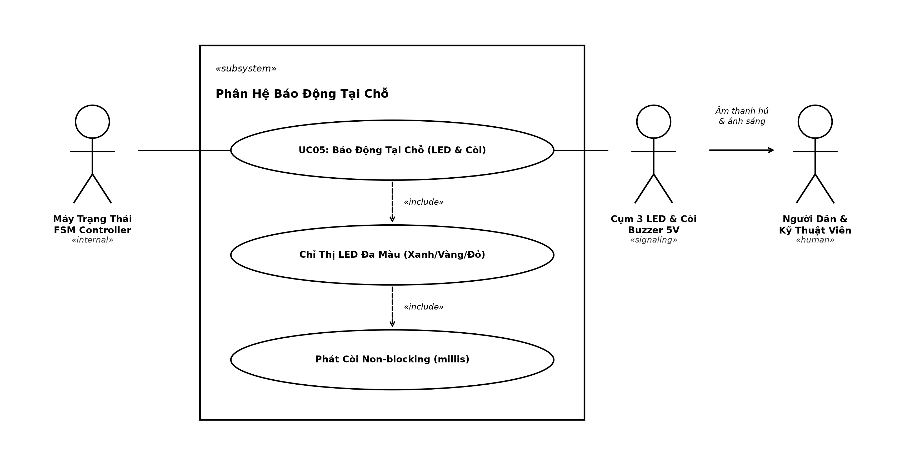

---

#### 🔹 UC06: Tự động chuyển đổi an toàn khi mất kết nối mạng (Failsafe to AUTO)
* **Mã định danh:** `UC06`
* **Tác nhân:** 
  * *Tác nhân Hệ thống:* Bộ định thời giám sát Watchdog / Heartbeat của ESP32.
  * *Tác nhân Mạng:* Kết nối Wi-Fi Client / Sóng vô tuyến RF.
* **Mục tiêu:** Bảo vệ trạm tự động chống ngập úng khi người vận hành mất quyền giám sát từ xa hoặc rớt mạng Wi-Fi.
* **Tiền điều kiện:** Hệ thống đang bị người vận hành gạt sang `MANUAL MODE`.
* **Luồng sự kiện chính:**
  1. ESP32 liên tục theo dõi thời điểm nhận bản tin HTTP request cuối cùng từ Client.
  2. Nếu phát hiện mất kết nối Wi-Fi hoặc mất heartbeat từ trình duyệt vượt quá thời gian quy định (Timeout):
     * ESP32 lập tức phát tín hiệu cảnh báo mất kết nối.
     * Cưỡng chế đảo cờ `isAutoMode = true` (chuyển ngay về `AUTO MODE`).
     * Trao lại quyền điều khiển van xả và máy bơm cho thuật toán FSM và cảm biến.
* **Hậu điều kiện:** Trạm duy trì tính năng tự trị (*Autonomous Controller*), ngăn chặn sự cố tràn bể nước do người dùng để quên ở chế độ thủ công.

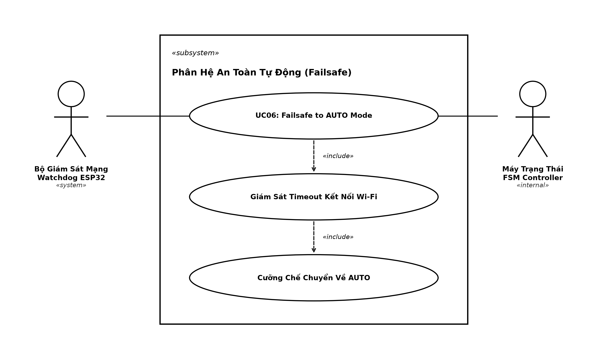

---

#### 🔹 UC07: Truyền nhận dữ liệu thời gian thực qua giao thức Web (Telemetry & API)
* **Mã định danh:** `UC07`
* **Tác nhân:** 
  * *Tác nhân Vi điều khiển:* ESP32 Web Server (thư viện `WebServer.h`, cổng 80).
  * *Tác nhân Mạng & Ngoại vi:* Trình duyệt Web máy tính / điện thoại qua mạng Wi-Fi (SoftAP hoặc Station).
* **Mục tiêu:** Cung cấp các giao diện lập trình ứng dụng (REST API endpoints) đóng gói JSON để truyền tải thông số đo và nhận lệnh điều khiển.
* **Tiền điều kiện:** Web Server khởi động thành công (`server.begin()`) trên cổng 80; Client kết nối chung dải mạng.
* **Luồng sự kiện chính:**
  1. `GET /`: Trả về toàn bộ mã nguồn giao diện Web Dashboard (HTML/CSS/JS) lưu trong bộ nhớ Flash `PROGMEM`.
  2. `GET /api/status`: Đóng gói dữ liệu chuỗi JSON chuẩn:
     ```json
     {"water":45, "distance":29.8, "rain":true, "rain_adc":1450, "state":"DANGER", "mode":"AUTO", "pump":true, "valve":50, "buzzer":"FAST"}
     ```
  3. `GET /api/control?action=...`: Tiếp nhận các tham số lệnh (`mode_toggle`, `pump_toggle`, `valve_0`, `valve_50`, `valve_100`).
* **Hậu điều kiện:** Dữ liệu thời gian thực được đồng bộ hai chiều liên tục giữa ESP32 và Web Client.

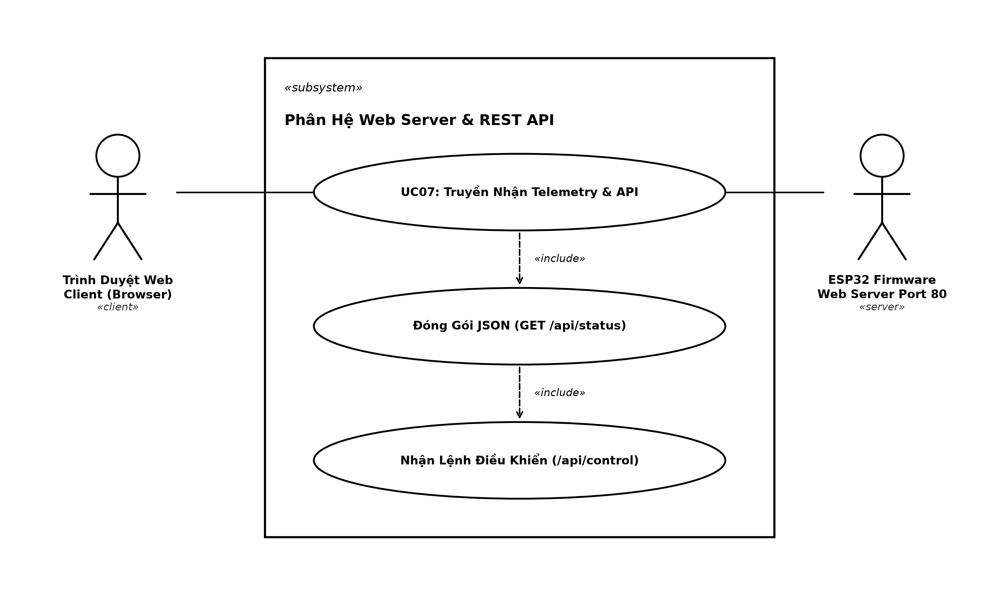

---

#### 🔹 UC08: Giám sát trạng thái trạm từ xa trên Giao diện Web
* **Mã định danh:** `UC08`
* **Tác nhân:** 
  * *Tác nhân Con người:* Người giám sát / Kỹ thuật viên vận hành trạm.
  * *Tác nhân Phần mềm:* Trình duyệt Web (Chrome, Edge, Safari).
* **Mục tiêu:** Hiển thị trực quan dữ liệu đo đạc và trạng thái phần cứng trên máy tính/điện thoại mà không cần màn hình LCD vật lý tại trạm.
* **Tiền điều kiện:** Thiết bị người dùng đã kết nối vào mạng Wi-Fi của trạm (`FloodGuard_AP`) hoặc cùng Router Wi-Fi.
* **Luồng sự kiện chính:**
  1. Người dùng mở trình duyệt, truy cập địa chỉ IP của ESP32 (ví dụ: `http://192.168.4.1` hoặc `http://floodguard.local`).
  2. Trình duyệt tải giao diện Dark Glassmorphism và kích hoạt JavaScript `fetch('/api/status')` định kỳ mỗi **1 giây** (Single Page Application - SPA).
  3. Giao diện tự động cập nhật động:
     * Đồng hồ/Thanh tiến trình đo mực nước (%) và khoảng cách (cm).
     * Badge trạng thái hệ thống: NORMAL (Xanh), WARNING (Vàng), DANGER (Cam), CRITICAL (Đỏ nhấp nháy).
     * Chỉ số cảm biến mưa: Khô ráo, Mưa nhỏ, Mưa to, Ngập nước.
     * Trạng thái thiết bị: Bơm ON/OFF, Van $0\%/50\%/100\%$, Còi báo động.
* **Hậu điều kiện:** Người dùng nắm bắt toàn diện diễn biến thời gian thực của trạm từ xa.

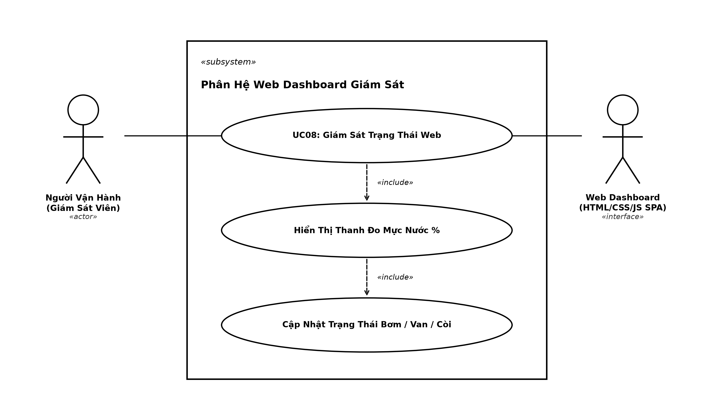

---

#### 🔹 UC09: Chuyển đổi chế độ vận hành từ xa (AUTO / MANUAL)
* **Mã định danh:** `UC09`
* **Tác nhân:** 
  * *Tác nhân Con người:* Kỹ thuật viên vận hành.
  * *Tác nhân Phần mềm & Phần cứng:* Trình duyệt Web, ESP32 Controller.
* **Mục tiêu:** Phân quyền điều khiển linh hoạt giữa thuật toán tự động thông minh và sự can thiệp thủ công của con người.
* **Tiền điều kiện:** Giao diện Web Dashboard đang kết nối bình thường với ESP32.
* **Luồng sự kiện chính:**
  1. Người dùng nhấn nút **"Đổi Chế Độ (AUTO / MANUAL)"** trên Dashboard.
  2. Trình duyệt gửi request ngầm: `GET /api/control?action=mode_toggle`.
  3. ESP32 tiếp nhận lệnh, đảo cờ trạng thái `isAutoMode = !isAutoMode`.
  4. Trình duyệt cập nhật badge hiển thị:
     * `AUTO`: Khóa/vô hiệu hóa các nút điều khiển trực tiếp bơm/van để bảo vệ logic tự động.
     * `MANUAL`: Mở khóa bảng điều khiển can thiệp thủ công (Manual Override).
* **Hậu điều kiện:** Quyền điều khiển được chuyển giao an toàn giữa vi điều khiển và người dùng.

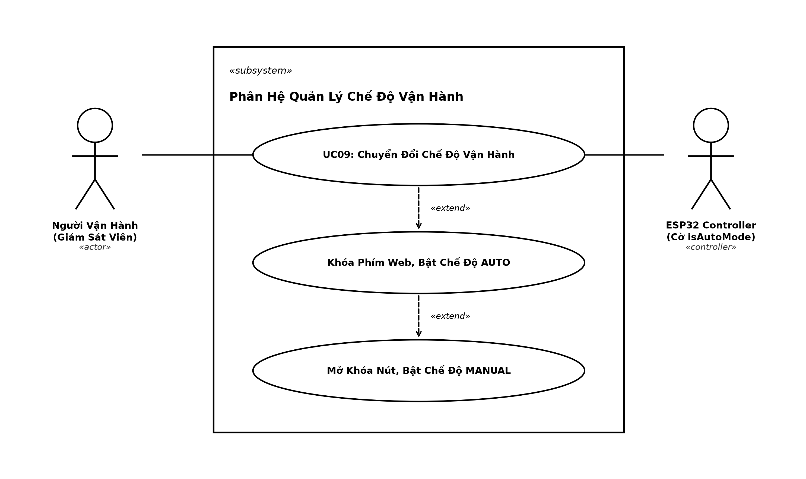

---

#### 🔹 UC10: Điều khiển cưỡng chế thiết bị chấp hành từ Giao diện Web
* **Mã định danh:** `UC10`
* **Tác nhân:** 
  * *Tác nhân Con người:* Kỹ thuật viên vận hành.
  * *Tác nhân Vi điều khiển & Chấp hành:* ESP32, Module Relay máy bơm, Động cơ Servo van xả.
* **Mục tiêu:** Bật/tắt bơm hoặc xoay góc van xả thủ công phục vụ kiểm tra thiết bị định kỳ, xả cặn đáy hồ, hoặc xử lý sự cố khẩn cấp.
* **Tiền điều kiện:** Hệ thống đang ở chế độ `MANUAL MODE` (`isAutoMode == false`).
* **Luồng sự kiện chính:**
  1. Người dùng nhấn các nút thao tác trên Dashboard Web:
     * Nhấn **"Bật/Tắt Bơm (Manual)"**: Gửi lệnh `pump_toggle`. ESP32 đảo trạng thái biến `pumpState` và kích hoạt Relay qua kỹ thuật High-Z.
     * Nhấn **"Van 0% (Đóng)"**, **"Van 50% (Mở Nửa)"**, hoặc **"Van 100% (Mở Hết)"**: Gửi lệnh `valve_0`, `valve_50`, hoặc `valve_100`. ESP32 điều khiển Servo quay tương ứng về $0^\circ, 90^\circ$, hoặc $180^\circ$.
  2. ESP32 áp đặt đầu ra phần cứng ngay lập tức qua hàm `applyOutputs()`.
  3. Web Server trả về mã phản hồi `200 OK`, Dashboard cập nhật trạng thái thiết bị hiển thị lên màn hình.
* **Hậu điều kiện:** Thiết bị chấp hành vận hành chính xác theo ý muốn của người điều khiển bất chấp giá trị cảm biến hiện tại.

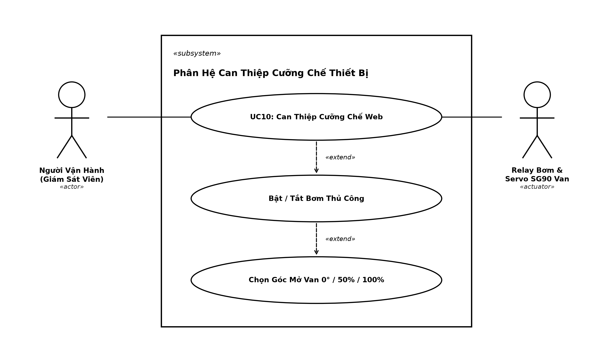

---

---

## 🚦 Các Trạng Thái Vận Hành & Ngưỡng Kích Hoạt
Hệ thống sử dụng cảm biến siêu âm với **khoảng đo từ 50cm (đáy hồ/cạn hoàn toàn - 0%) đến 5cm (mặt hồ đầy tràn - 100%)**, dải chênh lệch $45\text{ cm}$.

Áp dụng thuật toán **FSM & Hysteresis** chống dao động bật/tắt thiết bị với hệ thống cảnh báo đa tầng:
- **🟢 NORMAL (0 – 20% | Khoảng cách 50cm – 41cm)**: Mực nước an toàn. LED xanh sáng, Bơm OFF, Van đóng 0%, Còi OFF (yên lặng).
- **🟡 WARNING (21 – 40% | Khoảng cách 40.5cm – 32cm)**: Nước bắt đầu dâng. LED vàng sáng, **Còi báo nhẹ (tiếng bíp ngắn ngắt quãng thưa)** nhắc nhở kỹ thuật viên.
- **🔴 DANGER (41 – 70% | Khoảng cách 31.5cm – 18.5cm)**: Nguy cơ ngập. LED đỏ sáng, Bơm ON, Van mở 50% (90°), **Còi báo dồn dập (nhịp bíp nhanh)** cảnh báo nguy hiểm.
- **🚨 CRITICAL (71 – 100% | Khoảng cách 18cm – 5cm)**: Ngập nghiêm trọng. LED đỏ nhấp nháy dồn dập, **Còi hú liên tục không ngắt**, Bơm ON, Van mở thoát lũ tối đa 100% (180°).
- **Hysteresis khi nước rút**: Khi mực nước giảm, Bơm và Van vẫn duy trì thoát nước cho đến khi mực nước rút hẳn xuống dưới **40% (khoảng cách > 32cm)** mới ngắt Bơm đóng Van, và giảm sâu dưới **20% (khoảng cách > 41cm)** mới trở lại NORMAL.

---

## 🌐 Giám Sát & Điều Khiển Từ Xa (Web Dashboard)
- Tích hợp **Web Server** trên ESP32 (cổng 80).
- Giao diện Dashboard Dark Glassmorphism theo dõi:
  - Thanh đo mực nước hồ thu (%) thời gian thực.
  - Trạng thái thời tiết / cảm biến mưa.
  - Trạng thái máy bơm, góc mở van, còi hú.
  - Chuyển đổi linh hoạt giữa chế độ **AUTO** và **MANUAL**.
  - Can thiệp điều khiển thủ công Bơm và Van trực tiếp qua các nút bấm trên giao diện Web Dashboard (chuyển Mode AUTO/MANUAL, Bật/Tắt Bơm, mở Van 0% - 50% - 100%). Không phụ thuộc vào nút nhấn cơ học giúp tăng độ bền chống ẩm ướt trong môi trường ngập lụt.
- 👉 Chi tiết kiến trúc và các bước thiết lập Wi-Fi / Web Server xem tại: [WEB_DASHBOARD_SETUP_GUIDE.md](WEB_DASHBOARD_SETUP_GUIDE.md).

---

## 🚀 Hướng Dẫn Chạy Giả Lập Wokwi
1. Cài đặt extension **Wokwi for VS Code** và **PlatformIO IDE**.
2. Biên dịch firmware bằng PlatformIO:
   ```bash
   pio run
   ```
   *(hoặc nhấn tổ hợp phím `Ctrl + Shift + B`)*
3. Mở file `diagram.json` và nhấn nút **Start Simulation** (hoặc nhấn `F1` chọn `Wokwi: Start Simulator`).

👉 Xem hướng dẫn chi tiết từng bước và bảng lệnh tại file: [SIMULATION_GUIDE.md](SIMULATION_GUIDE.md).
